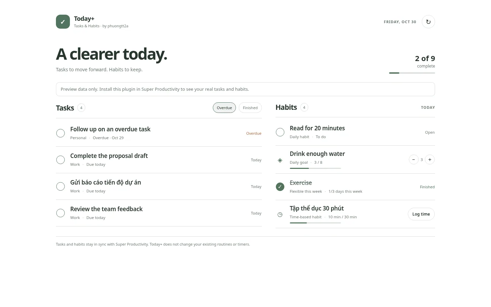
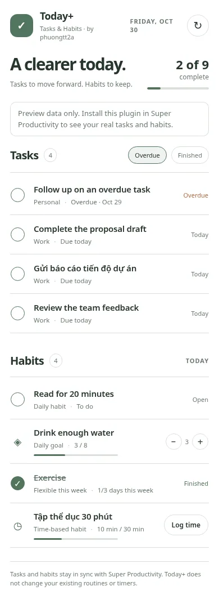

# Today+

**Your tasks and habits, together.**

Today+ is an independent, community-built plugin for [Super Productivity](https://app.super-productivity.com/), created by [phuongtt2a](https://github.com/phuongtt2a). It brings **tasks due today** and **habits scheduled for today** onto one calm screen, so you can see your work and routines without switching views.

> Today+ is separate from [Five](https://github.com/phuongtt2a/super-productivity-five), the five-priority focus plugin. Installing either does not replace the other.

[](https://app.super-productivity.com/) [](LICENSE)

## Preview



<details>
<summary>Mobile layout and manual time entry</summary>




</details>

*Screenshots use demonstration tasks and habits, not real account data.*

## Why Today+?

Super Productivity organizes tasks and habits in different views. **Today+ brings tasks due today and habits scheduled for today together**, helping you review your work and routines without switching screens. Complete tasks, track habit goals and manually log time spent without replacing the native habit tracker.

## What it shows

- **Today's tasks:** See work due today, with overdue tasks included when you want them. You can also show completed tasks.
- **Today's habits:** See routines scheduled for today, including habits you aim to complete several times each week.
- **Your progress:** Check what's finished, what's still pending, and how close you are to each habit's goal.
- **Simple actions:** Finish or reopen a task, check off a habit, adjust a daily count, or log time already spent on a time-based habit.
- **A comfortable view:** Everything is together on one screen, with a clean layout that works on laptops and phones and follows your Super Productivity theme.

Today+ uses your existing tasks and habits. There's no separate account or second set of lists to maintain.

## Install

1. Open the [latest Today+ release](https://github.com/phuongtt2a/super-productivity-today-plus/releases/latest).
2. Under **Assets**, download **`today-plus-super-productivity.zip`** (not GitHub's **Source code (zip)**).
3. In [Super Productivity](https://app.super-productivity.com/), go to **Settings → Plugins** and choose **Choose Plugin File**.
4. Import the downloaded ZIP **without unpacking it**. Then open **Today+** from the plugin menu.

The installable ZIP contains exactly four root files:

```text
today-plus-super-productivity.zip
├── manifest.json
├── plugin.js
├── index.html
└── icon.svg
```

## What counts as today?

**Tasks** appear when their due date is today or earlier. You can hide overdue tasks or show tasks you've already finished. Tasks without a due date aren't automatically added.

**Habits** appear according to the schedule you've set in Super Productivity. Weekly-frequency habits stay available during the week so you can work toward your goal.

**Time-based habits** show the time you've already recorded. To add time manually, pause the habit's stopwatch in Super Productivity, select **Log time** in Today+, and enter the minutes you've spent. This adds to your recorded time; it doesn't start or stop the stopwatch.

## Good to know

- Today+ doesn't create tasks or habits. You can create them and change their schedules in Super Productivity.
- Progress and completed tasks remain in Super Productivity, so you can return to the main app anytime.
- If you update a habit in another screen, Today+ may need a moment to refresh.
- Today+ is a community-made plugin, not an official feature of Super Productivity.

## For contributors

The plugin is open source. If you want to explore the code or contribute, see the [development guide](docs/DEVELOPMENT.md), [release guide](docs/RELEASING.md), and [official Super Productivity plugin documentation](https://github.com/super-productivity/super-productivity/blob/master/docs/plugin-development.md).

For technical details about how tasks and habits are read and updated, see [DEVELOPMENT.md](docs/DEVELOPMENT.md).

## About and releases

- [Repository description, website and topics](docs/ABOUT.md)
- [Release notes and version history](CHANGELOG.md)
- [How to publish a new version](docs/RELEASING.md)

## Contributing

Issues and pull requests are welcome. Please read [CONTRIBUTING.md](CONTRIBUTING.md). License: [MIT](LICENSE).
