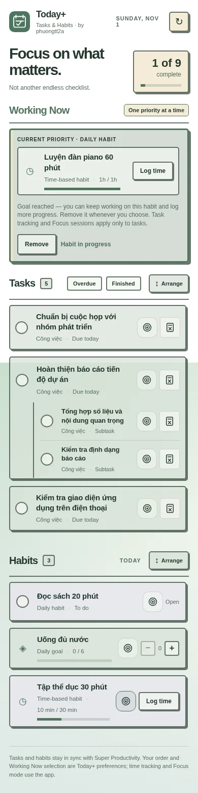
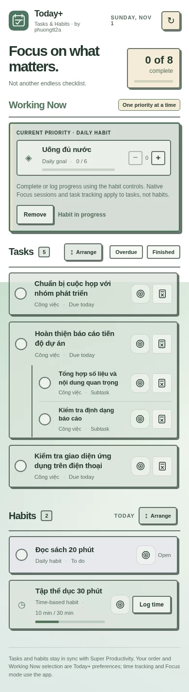

# Today+

**Focus on what matters. Not another endless checklist.**

> Today+ is separate from [Five](https://github.com/phuongtt2a/super-productivity-five), the five-priority focus plugin. Installing either does not replace the other.

[](https://app.super-productivity.com/) [](LICENSE)

## Today+ 2.0 — Your daily workspace

Manage today's **tasks and habits together**, arrange them in your preferred order, and bring one task or habit into **Working Now**. Uses Super Productivity's data, native task tracking, and Focus mode—without creating duplicate tasks or timers.

### Working Now — task and habit previews

| Working on a task (desktop) | Continuing a completed habit (mobile) |
| :--- | :--- |
|  |  |

<details>
<summary>More screenshots — arranging, habits, and compact mobile layout</summary>





</details>

## Why Today+?

Super Productivity organizes tasks and habits in different views. Today+ brings **tasks due today** and **habits scheduled for today** onto one screen, reducing the need to switch back and forth while keeping Super Productivity as the source of truth. You can complete tasks, update habit goals, and manually log time without replacing the native habit tracker.

## Features

- **Arrange your day:** Open **Arrange** in Tasks or Habits. Drag by the grip or use the keyboard/touch-friendly **Move to top / Move up / Move down** controls. Top-level tasks move as a group; subtasks are arranged within their parent. This changes only Today+'s display, not project order.
- **Saved routines:** Task order is saved per logical day; habit order remains your preferred recurring daily routine. Today+ saves the preferences using Super Productivity's synced plugin storage, where supported.
- **Working Now:** Tap the target icon on one task or habit to bring it into **Working Now**, without copying, completing, or automatically tracking it. Pick another task or habit to replace it; **Remove** returns it to the normal list. Habits retain their native Complete/Increase/Log time controls, even after meeting their daily goal.
- **Native tracking and Focus:** **Start tracking / Stop tracking** uses the application's own time tracker, with an approved action fallback for older hosts lacking the newer optional tracking methods. **Focus on task** activates your selected Working Now task before opening Super Productivity's native Focus interface. It does **not** automatically start a Pomodoro or replace its built-in timer. Native task tracking and Focus sessions do not apply to habits.

- **Today’s tasks:** See tasks due today, with subtasks nested beneath their parents. Overdue and completed tasks are hidden at first; you can show either when needed.
- **Native Won't Do:** Tap **Won’t Do** to invoke Super Productivity’s native skip using its task-row menu. Today+ briefly visits the native task list if needed, visually conceals only the temporary task menu, and returns to Today+. Task details do not open. If the native menu cannot be reached, it leaves the task unchanged and shows guidance. Native recurrence and completion semantics are preserved.
- **Scheduled habits:** Read existing enabled habits from Super Productivity. Follow weekday schedules; show weekly-frequency habits during the week.
- **Single-completion habits:** Tap once to complete; tap again to undo.
- **Count or goal-based habits:** Increase or decrease today's value and see progress toward the configured goal.
- **Stopwatch habits:** View accumulated time and the target. Use **Log time** to manually add minutes already spent **only when the built-in stopwatch is not running**. Today+ does not start, stop, or replace the app's timer.
- **One dashboard:** See both sections and overall progress; it automatically refreshes periodically and when the app regains focus.
- **Theme and mobile:** Uses Super Productivity's font and theme variables, keeps the host wallpaper visible, supports light/dark mode and small phone screens.

No separate login, external service, duplicate tasks, or additional local data store is required.

> **Known limitation in v2.0.0:** Won't Do uses Super Productivity's native task menu through a plugin-side workaround. Today+ may briefly switch to the host task list and back, causing a momentary screen blink. We are retaining this behavior for now rather than faking task completion or changing recurring-task schedules. The action is verified by checking the native `wontDoOn` state; UI automation may need maintenance after host updates.

> **What's new in v2.0.0:** User-tested Working Now for tasks and habits, persistent display order, native tracking/Focus handoff, and the NEO-Zen responsive layout. See [2.0.0 release notes](CHANGELOG.md) and [workspace verification](docs/WORKSPACE-VERIFICATION.md).

## Install

1. [Download the latest installable Today+ ZIP](https://github.com/phuongtt2a/super-productivity-today-plus/releases/latest/download/today-plus-super-productivity.zip) from the official latest GitHub Release. New builds are published automatically after tested changes merge into `main` (including same-version UI fixes). Install the ZIP under **Assets**, not GitHub's automatically generated source archive.
2. In [Super Productivity](https://app.super-productivity.com/), go to **Settings → Plugins** and choose **Choose Plugin File**.
3. Import the downloaded ZIP **without unpacking it**. Then open **Today+** from the plugin menu.


The installable ZIP contains exactly four root files:

```text
today-plus-super-productivity.zip
├── manifest.json
├── plugin.js
├── index.html
└── icon.svg
```

## What's new in 2.0

**Choose your current priority.** Tap the target icon beside a task or habit to move it to the green-and-gold **Working Now** area. Select something else to replace it, or use **Remove**. Nothing is duplicated; progress stays accurate.

**Arrange the day your way.** The **Arrange** action sits at the far right of Tasks and Habits, separate from the Overdue/Finished filters. Drag rows or use accessible Move to top, Up and Down controls. Task/subtask order is specific to the day; habit order is a recurring preference.

**Use Super Productivity's own tools.** A task in Working Now offers **Start tracking**, **Stop tracking**, and **Focus on task**. The plugin hands off to the application's native tracker and focus interface. `Not tracking` and `Tracking in Super Productivity` describe status, not separate timers. Focus on task selects the task first; the native app controls the focus session.

**Keep going after a habit goal.** Even if a habit is already Done for the day, it can go into Working Now. Example: a 60-minute reading or piano habit can accumulate 90 minutes without counting as two completed habits. You decide when to remove it.

## Organizing tasks and habits

Open **Arrange** in either list to reveal a drag handle and Move to top/up/down buttons. Parent task rows move as a group, and subtasks are rearranged inside their parent. On phones and with keyboard or assistive technology, the explicit buttons are an alternative to dragging.

Today+'s task order resets each logical day; recurring habits retain the order you chose until you change it. Ordering and the Working Now selection (task or habit) are stored as preferences, not copied items. No native task project order is changed, and progress totals still include the task in Working Now.

Selecting a task for Working Now does not start time tracking. Start/Stop operates on the native tracker when supported. The app's `currentTaskChange` event supplies updates while Today+ is running; a refreshed iframe cannot reliably read the already-active tracker, so it does not claim tracking is active unless confirmed. Removing a task from Working Now does not stop native tracking.

## How the daily view works

Today+ starts with tasks due **today** and habits scheduled for **today**. Subtasks appear directly beneath their parent task. **Overdue** and **Finished** are hidden by default; turn on either filter to see more.

Habits follow your existing Super Productivity schedule. Daily habits show today's progress, while flexible weekly habits show progress toward their weekly goal. Nothing needs to be configured a second time inside Today+.

## What “Won't Do” means

Choose the compact **task-with-X icon** (with the exact tooltip and accessibility label **"Won't Do"**) to intentionally skip the current task occurrence using Super Productivity's **native Won't Do** action. Unlike the old **Not Today** action, this does **not** clear the scheduled date and is not a normal Done completion. The host records the skipped outcome; for recurring tasks, the app controls when the next occurrence appears.

Today+ hides finished tasks by default. Turn on the **Finished** filter to review a skipped occurrence labelled **Won't Do** (×). If the host task row cannot be reached safely, the task is left unchanged and Today+ explains the problem. A brief screen blink may occur because the plugin temporarily visits the native task list.


## Safety and limitations

- Today+ does not create tasks or habits. Manage definitions and habit schedules in the main Super Productivity app.
- To log a stopwatch habit, pause its existing stopwatch in Super Productivity first. The dialog **adds** time already spent, not a replacement total. It does not control the native stopwatch or countdown reminders.
- Updates to habits made in another screen may appear after refresh or when the plugin regains focus. The API does not provide a dedicated habit-change hook.
- In a desktop app or mobile app, Super Productivity's own stored data remains the source of truth. In a standalone browser preview without the plugin API, Today+ shows explicitly labelled demo data only.
- Compatible with Super Productivity versions exposing the documented iframe Plugin API, including `getAllSimpleCounters()` and `setCounter()`. Older versions may differ; please report issues with app version and reproduction steps.
- Today+ is a community project, not an official Super Productivity feature or an affiliated product.

## Development

Today+ is intentionally lightweight: no framework, build chain, external scripts or network requests.

```text
plugin/               # Files packaged at ZIP root
scripts/package.py    # Deterministic ZIP builder
scripts/              # Preview and screenshot helpers
tests/                # Package and browser integration tests
docs/                 # Screenshots and guides
.github/workflows/    # PR validation and automatic release publishing
```

Run from the repository root:

```bash
python -m unittest discover -s tests -p 'test_*.py' -v
python scripts/package.py --tag v2.0.0
```

For browser tests, install Python Playwright and Chromium, then run `python tests/integration_check.py` and `python tests/browser_check.py`. See [development notes](docs/DEVELOPMENT.md) and [release instructions](docs/RELEASING.md).

For the official plugin contract, see the [Super Productivity Plugin Development Guide](https://github.com/super-productivity/super-productivity/blob/master/docs/plugin-development.md).

## About and releases

- [GitHub About details](docs/ABOUT.md): description, website and repository topics.
- [Changelog](CHANGELOG.md): version history.
- [Release instructions](docs/RELEASING.md): how the four-file ZIP is built and verified.

## Contributing

Issues and pull requests are welcome. Please read [CONTRIBUTING.md](CONTRIBUTING.md). License: [MIT](LICENSE).

### NEO-Zen design family

Today+ uses the shared [NEO-Zen Design System](docs/NEO-ZEN-DESIGN.md) with Five and Deadline Watch: crisp outlines, hard offset shadows, thoughtfully tinted task/habit cards and a 1220px shared desktop shell. The plugin's runtime font remains **Super Productivity's own configured font**, including Vietnamese diacritics. The iframe and page canvas are **transparent** so the host wallpaper and opacity settings remain visible through theme-aware individual surfaces. No task, habit or Not Today behavior changes were made for this visual refresh. The screenshots above were regenerated from synthetic Vietnamese sample data and checked at desktop, 390px and 320px.
